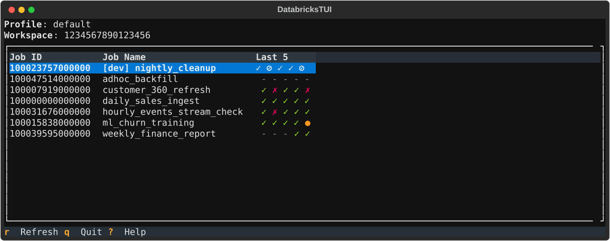

# dbxj

A keyboard-driven terminal UI for browsing Databricks jobs, their runs and task logs.



- See every job with the results of its last 5 runs at a glance
- Drill into a job's runs, a run's tasks and a task's output or error trace
- Filter jobs by name, trigger a job, open anything in the browser
- Switch workspaces with `--profile`; re-login happens in-app when your session expires

TUI is built with [Textual](https://textual.textualize.io/).

# Install

```sh
uv tool install dbxj      # or: pipx install dbxj
```

Requirements:

- Python 3.11+
- A profile in `~/.databrickscfg`, e.g. from `databricks auth login --host <workspace-url>`
- The [Databricks CLI](https://docs.databricks.com/dev-tools/cli/install.html) on your `PATH`, used
  to log in again when your session has expired

Try it without a workspace:

```sh
dbxj --demo
```

Upgrade with `uv tool upgrade dbxj` and remove with `uv tool uninstall dbxj`.

# Usage

```sh
dbxj --profile <profile name>   # a profile from ~/.databrickscfg
dbxj --demo                     # bundled demo data, no workspace needed (alias: --offline)
```

If `--profile` isn't given, `DATABRICKS_CONFIG_PROFILE` or the SDK's default auth is used. On start
the login is checked; if it's expired a dialog appears and `databricks auth login` opens your browser,
then the app continues once you've logged in.

| Key | Action |
| --- | --- |
| `r` | Refresh the current view |
| `q` | Quit |
| `?` | Show all key bindings (`esc` closes) |
| `/` | Filter jobs by name (kept while you drill in) |
| `t` | Trigger the selected job (asks to confirm) |
| `o` | Open the selected job, run or task in the browser |
| `enter` / `esc` | Drill into / back out of jobs, runs and tasks |
| `j` / `k`, `d` / `u` | Down / up, page down / up |

# Development

Requires [uv](https://docs.astral.sh/uv/) and optionally [just](https://github.com/casey/just).

```sh
uv sync                    # create .venv
uv run pre-commit install
uv run dbxj --demo         # or: just run_offline / just run <profile>
uv run pytest
```

- In demo mode, data is read from `./cached` if that directory exists, otherwise from
  `src/dbxj/sample_data` (regenerate with `uv run scripts/generate_sample_data.py`)
- `scripts/` has helpers to create, trigger and delete test jobs in a workspace
- `docs/design.md` describes how the app is put together

# License

MIT
